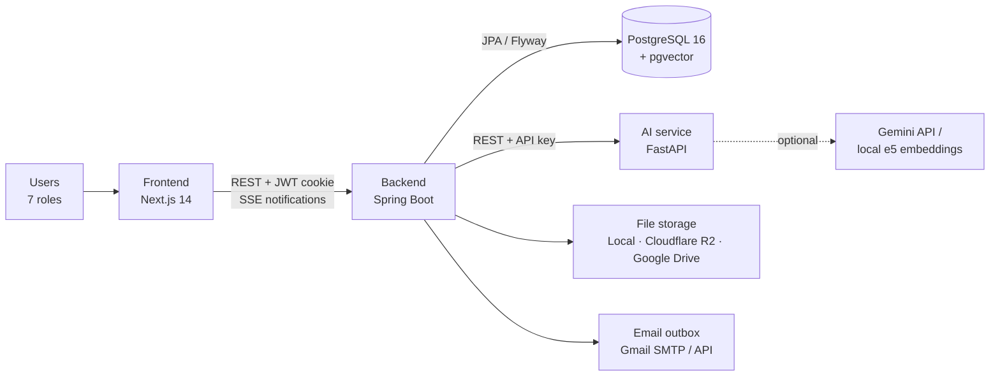

# 🎓 InternLink

**Internship management platform with AI skill matching**
for the College of ICT (CICT) – Can Tho University

---

InternLink manages the full graduation-internship lifecycle between **students**, **companies** and the **university**:

- **Finding a placement** — job board, AI job recommendations, CV–JD gap analysis, in-app applications (Kanban, interviews, offers) or external company channels, acceptance forms and referral letters.
- **During the term** — lecturer assignment, daily/weekly logs, mentor feedback, Google Meet meetings, exception handling.
- **End of term** — faculty dossier submission, CLO-based grading, AI digitization of paper evaluation forms, result publishing and analytics.

## 📦 Repositories

| Repository | Role | Tech |
|---|---|---|
| [**Internlink-v1-backend**](https://github.com/internlink-v1/Internlink-v1-backend) | Business API, auth & RBAC, storage, email outbox, real-time notifications | Spring Boot 3.3, Java 21, JPA, Flyway, PostgreSQL 16 + pgvector |
| [**Internlink-v1-frontend**](https://github.com/internlink-v1/Internlink-v1-frontend) | Web portal for 7 user roles, responsive | Next.js 14 App Router, TypeScript, Tailwind CSS, TanStack Query |
| [**Internlink-v1-ai**](https://github.com/internlink-v1/Internlink-v1-ai) | Skill extraction, job matching, CV–JD analysis, RAG assistant, form reading | FastAPI, IT skill taxonomy, Gemini / local e5 embeddings |

## 🏗️ Architecture

The AI service is stateless and never touches the database. If it is down, the core workflow keeps running and AI features fail gracefully.

## ✨ Highlights

- **310+ REST endpoints** across modules: auth, recruitment, placement, evaluation, meetings, analytics, AI matching.
- **7 roles**: Student, Company HR, Mentor, Lecturer, Faculty admin, School office, System admin.
- **AI job matching**: hybrid ranking of hard-skill overlap and semantic similarity, with explanations of matched and missing skills.
- **CapyLink assistant**: RAG chatbot answering questions about internship regulations, with cited sources.
- **Paper form digitization**: Gemini reads scanned company evaluation forms (10 criteria + comments); the lecturer reviews and confirms.
- **Real-time notifications** via Server-Sent Events, **email outbox** with safe delivery modes (DISABLED / REDIRECT / ALLOWLIST / LIVE).
- **1,300+ automated tests** (JUnit, pytest, Vitest) with GitHub Actions CI.

## 🖼️ Screenshots

| Student dashboard | AI support for students |
|---|---|
|  |  |
| **Faculty analytics** | **Lecturer grading & CLO** |
|  |  |

## 👤 Author

**Nguyễn Hoàng Hào** — Information Technology student, Can Tho University
GitHub: [@hao05dev](https://github.com/hao05dev)

Graduation thesis project, 2026.
